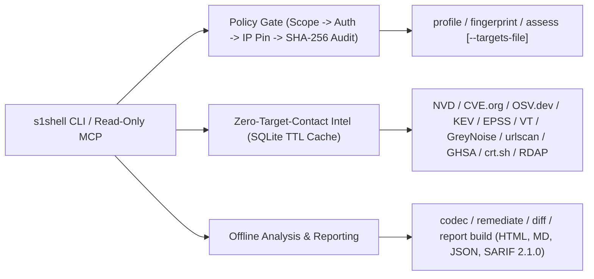

# S1shell

[](CHANGELOG.md)
[](pyproject.toml)
[](LICENSE)
[](.github/workflows/ci.yml)

**S1shell** is an open-source, defensive security assessment CLI toolkit built for Kali Linux and standard Linux environments. It unifies **scoped read-only target profiling**, **passive technology & EOL fingerprinting**, **CVE / KEV / EPSS & multi-ecosystem SBOM auditing**, **7-feed passive threat intelligence & OSINT (`crt.sh` / RDAP)**, **offline CyberChef-style codec & token inspection**, **deterministic hardening playbooks**, **posture drift diffing**, **multi-provider defensive AI triage**, **SARIF / HTML / Markdown reporting**, and a **19-tool read-only offline MCP server** behind a fail-closed authorization gate.



### Contents

- [Key Capabilities](#key-capabilities)
- [Authorized-Use Notice & Non-Goals](#authorized-use-notice)
- [**Part 1: Setup & Configuration**](#part-1-setup--configuration) *(One-time install, shell completion, API keys, MCP, custom signatures)*
- [**Part 2: Pentesting & Assessment Guide (`https://www.target.com`)**](#part-2-pentesting--assessment-guide-example-httpswwwtargetcom) *(End-to-end 5-phase engagement walkthrough)*
- [**Part 3: Reference, CI/CD & Troubleshooting**](#part-3-reference-cicd--troubleshooting) *(CI gates, command table, flags, exit codes, troubleshooting)*

---

## Key Capabilities

- **Fail-Closed Scope & Governance**: Allow/deny (`--exclude`) scope rules, bulk scope import (`scope import --dry-run`), DNS rebinding & private/CGNAT (`100.64.0.0/10`)/NAT64 (`64:ff9b::/96`)/IPv4-mapped IPv6/metadata IP guards, atomic `0600` writes for `scope.yaml` & `.env`, IP-pinned HTTP/TLS connections, and a file-locked (`fcntl.flock`) `O(1)` SHA-256 hash-chained `audit.log` (`audit verify`).
- **Deep Read-Only Profiling**: DNS hygiene (`A`/`AAAA`/`CNAME`/`MX`/`NS`/`CAA`/recursive RFC 7208 `SPF` + void lookup & loop check/`DMARC`/`MTA-STS`/`TLS-RPT`/`BIMI`/`DANE TLSA`/`DNSSEC`/dangling CNAME + expanded PSL zone-apex fallback), full X.509 certificate chain + CAA-vs-Issuer alignment + TLS 1.0–1.3 matrix/SPKI pin hash, directive-level CSP v2/CORS/HSTS/cache/debug-header/cookie analysis, zero-extra-packet passive HTML inspection (redacted secret/JWT/source-map/stack-trace detection), and opt-in `OPTIONS` method & RFC well-known (`security.txt`, `robots.txt`, OIDC `openid-configuration`, `jwks.json`, mobile trust) review.
- **81 Passive Fingerprints, Client Library CPEs & Offline EOL DB**: Identifies web servers, CDNs, WAFs, DevOps platforms, frameworks, and client-side JS libraries (`jQuery`, `Bootstrap`, `Lodash`, `Moment.js`, `DOMPurify`, `Handlebars`, `Axios`, `Swagger UI`) with automatic CPE 2.3 correlation, offline **End-of-Life (`EOL-001`)** flagging, and custom `~/.s1shell/signatures.d/*.yaml` support.
- **CVE, KEV, EPSS, GHSA & Multi-Ecosystem SBOM Auditing**: NVD 2.0 + CVE.org + GitHub Security Advisories + CISA KEV + FIRST EPSS with SSVC-style `P0-IMMEDIATE`..`P3-MONITOR` tiers and pure-Python **CVSS v3.1 vector scoring**, plus recursive zero-target-contact **OSV.dev** lockfile & SBOM scanning (`requirements.txt`, `uv.lock`, `poetry.lock`, `Pipfile.lock`, `package-lock.json`, `yarn.lock`, `pnpm-lock.yaml`, `go.mod`, `Cargo.lock`, `composer.lock`, `Gemfile.lock`, `pom.xml`, CycloneDX, and **SPDX 2.3**) with highest-version semantic upgrade commands.
- **7-Feed Passive Threat Intel & OSINT (`s1shell intel`)**: Cached, zero-target-contact lookups with bounded HTTP `429`/`502`/`503`/`504` `Retry-After` backoff across **VirusTotal v3**, **GreyNoise Community**, **urlscan.io Search API**, **GitHub Advisories (GHSA)**, **NVD**, plus zero-API-key **Certificate Transparency (`crt.sh`)** and **RFC 7480–7484 RDAP** domain/IP registration intelligence.
- **Deterministic Playbooks, Presets, Drift Diffs & SARIF**: Assessment presets (`web`, `api`, `strict`), transparent finding waivers (`--ignore-finding`), OWASP Top 10:2021 / ASVS / CWE / NIST 800-53 mapping, offline config snippets (`nginx`, `apache`, `caddy`, `express`, `dns`, `security.txt`), `diff --fail-on-regression`, and CI policy gates (`exit 4`).
- **Multi-Provider Defensive AI, Offline Codec & Read-Only MCP**: Supports **Anthropic**, local air-gapped **Ollama**, **OpenAI-compatible**, and **Google Gemini** with prompt-injection tagging (`<untrusted_telemetry>`) and reversible NDA-safe redaction (`--redact` for hostnames, IPv4/IPv6, emails, scope IDs, cookies, auth/API-key headers, query secrets, & inline JWTs), an offline CyberChef-style **Codec & Token Inspector** (`codec decode|encode|inspect|hash` for Base64/Hex/URL/HTML/Unicode/SAML/JWT/X.509/Gzip/Auto), plus a 19-tool read-only JSON-RPC 2.0 stdio MCP server (`mcp serve`).

---

## Authorized-Use Notice

S1shell is strictly intended for use on systems you **own** or have **explicit written authorization** to evaluate.

Every target-touching operation enforces a fail-closed policy gate:
1. **Scope First (`exit 2`)**: No packet is sent unless the target and its resolved IP addresses match an active, unexpired allow entry (and no `--exclude` rule, including IPv4-mapped IPv6/NAT64 unwrapping) in `~/.s1shell/scope.yaml`, and domain entries cannot silently resolve to un-scoped loopback, private, RFC 6598 CGNAT (`100.64.0.0/10`), NAT64 (`64:ff9b::/96`), or cloud metadata IPs.
2. **Explicit Authorization (`exit 3`)**: Target commands require `--authorized` or interactive TTY confirmation. Non-interactive runs without `--authorized` fail immediately.
3. **Tamper-Evident Audit Logging**: Every network attempt appends a file-locked (`fcntl.flock`), SHA-256 hash-chained JSONL record to `~/.s1shell/audit.log` (`0600`), verifiable offline via `s1shell audit verify`.

### What S1shell Does Not Do

By design, S1shell **never** implements or accepts plugins for:
- Exploitation, exploit payloads, or vulnerability PoC execution
- Payload generation or active vulnerability probing/fuzzing (SQLi/XSS/SSRF/LFI strings)
- WAF bypass, firewall evasion, request smuggling, or browser User-Agent spoofing
- Rate-limit evasion, proxy rotation, or IP rotation
- Brute force, password spraying, credential testing, or directory/subdomain enumeration
- Port scanning, host discovery, denial-of-service testing, or target state modification

---

## Part 1: Setup & Configuration

Complete these steps **once** on your Kali Linux or Linux workstation before running an assessment.

### 1.1 Install S1shell

#### Clone Repository

```bash
git clone https://github.com/willygailo/ProjectPY.git
cd ProjectPY
```

#### Option A — Kali Linux (Recommended)

```bash
./scripts/install-kali.sh
# Or editable development setup inside .venv:
./scripts/install-kali.sh --dev
```

#### Option B — Standard Linux / Python 3.10+ with `pipx`

```bash
pipx install .
# Upgrade an existing local install after `git pull`:
pipx install --force .
```

#### Option C — Contributor / Local Source Verification

```bash
make setup
source .venv/bin/activate
make check
```

> Running directly from source without `pipx`? Replace `s1shell` with `PYTHONPATH=src python3 -m s1shell` in all commands below.

### 1.2 Enable Shell Tab-Completion (`bash`, `zsh`, `fish`)

```bash
# Bash
mkdir -p ~/.local/share/bash-completion/completions
s1shell completion bash > ~/.local/share/bash-completion/completions/s1shell

# Zsh
mkdir -p ~/.zsh/completions
s1shell completion zsh > ~/.zsh/completions/_s1shell

# Fish
mkdir -p ~/.config/fish/completions
s1shell completion fish > ~/.config/fish/completions/s1shell.fish
```

### 1.3 Configure Optional API Keys & AI Provider (`.env`, Atomic `0600`)

All API keys are **optional** — S1shell works out of the box with unauthenticated NVD, CVE.org, OSV.dev, `crt.sh`, and RDAP. When configured, keys are written atomically with `0600` permissions (gitignored and always masked in output) and resolve in order: **process environment > project `./.env` > `~/.s1shell/.env`** (see [.env.example](.env.example)).

```bash
# Save passive threat-intelligence & CVE quota keys
s1shell intel env \
  --set-nvd-key "YOUR_NVD_KEY" \
  --set-github-key "YOUR_GITHUB_TOKEN" \
  --set-vt-key "YOUR_VT_KEY" \
  --set-greynoise-key "YOUR_GREYNOISE_KEY" \
  --set-urlscan-key "YOUR_URLSCAN_KEY"

# Inspect masked threat-intel key status
s1shell intel env

# Configure local air-gapped Ollama (zero cloud telemetry) — or anthropic / openai_compat / gemini
s1shell ai env --provider ollama --model "llama3.1:8b"
# Example cloud provider:
# s1shell ai env --provider anthropic --set-key "sk-ant-api03-..." --model "claude-sonnet-4-20250514"
```

| Environment Variable | Module | Purpose |
|---|---|---|
| `NVD_API_KEY` | `cve`, `assess` | Raises NVD 2.0 quota from 5 req/30s to 50 req/30s |
| `GITHUB_TOKEN` | `intel`, `cve` | Authenticates GitHub Security Advisories (GHSA) lookups & CVE enrichment |
| `VIRUSTOTAL_API_KEY` | `intel`, `assess --intel` | Passive VirusTotal v3 domain/IP reputation |
| `GREYNOISE_API_KEY` | `intel`, `assess --intel` | Passive GreyNoise Community IP scanner & benign RIOT lookup |
| `URLSCAN_API_KEY` | `intel`, `assess --intel` | Passive urlscan.io historical Search API index lookup |
| `S1SHELL_AI_PROVIDER` | `ai`, `assess --ai` | `anthropic` (default), `ollama`, `openai_compat`, or `gemini` |
| `ANTHROPIC_API_KEY` / `OPENAI_API_KEY` / `GEMINI_API_KEY` | `ai` | Cloud LLM inference credentials (not needed for local `ollama`) |
| `S1SHELL_HOME` | All | Override state directory (default `~/.s1shell`) |

### 1.4 Verify Your Setup

```bash
s1shell doctor
s1shell audit verify
```

### 1.5 Optional Integrations (Custom Signatures & Read-Only MCP Server)

#### Custom Passive Fingerprint Rules (`~/.s1shell/signatures.d/`)

Drop any `*.yaml` file into `~/.s1shell/signatures.d/` to extend S1shell's 81 bundled passive rules without editing source code:

```yaml
signatures:
  - vendor: "Internal Corp"
    product: "Custom Edge Gateway"
    category: "waf"
    confidence: "high"
    headers:
      - name: "x-corp-edge"
        pattern: "^edge/([\\d.]+)"
```

#### Read-Only Offline MCP Server (`s1shell mcp serve`)

Exposes **19 strictly read-only offline/intel tools** over JSON-RPC 2.0 stdio with zero target-touching capability:

- **Governance & Audit:** `s1shell_doctor`, `s1shell_scope_list`, `s1shell_scope_check`, `s1shell_audit_list`, `s1shell_audit_verify`
- **CVE & Supply Chain:** `s1shell_cve_search`, `s1shell_cve_get` (single `cve_id` or batch `cve_ids`), `s1shell_cve_audit` (all 14 lockfile/SBOM formats + `recursive` directory scan)
- **Passive Threat Intel & OSINT:** `s1shell_intel_lookup` (VT, GreyNoise, urlscan.io Search, RDAP), `s1shell_intel_advisory` (GHSA), `s1shell_intel_ct` (`crt.sh`), `s1shell_intel_rdap`
- **Offline Analysis & Codec:** `s1shell_fingerprint_from_profile`, `s1shell_assess_diff`, `s1shell_remediate`, `s1shell_codec_decode`, `s1shell_codec_encode`, `s1shell_codec_inspect`, `s1shell_codec_hash`

Add to your MCP client configuration:

```json
{
  "mcpServers": {
    "s1shell": {
      "command": "s1shell",
      "args": ["mcp", "serve"]
    }
  }
}
```

---

## Part 2: Pentesting & Assessment Guide (Example: `https://www.target.com`)

This walkthrough shows how to use S1shell across a full authorized web & AppSec engagement targeting **`https://www.target.com`**.

### Command Modes at a Glance

| Mode | Scope & `--authorized` Required? | Commands |
|---|---|---|
| **Zero-Target-Contact (Passive / Offline)** | No — never sends packets to `target.com` | `intel ct\|rdap\|lookup\|advisory`, `cve search\|get\|audit`, `codec decode\|encode\|inspect\|hash`, `fingerprint --from-profile`, `remediate`, `diff`, `report build`, `audit` |
| **Authorized Target Mode (Read-Only)** | **Yes** — must match `scope.yaml` + `--authorized` | `assess <target \| --targets-file>`, `profile <target>`, `fingerprint <target>` |

---

### Phase 1 — Pre-Engagement Passive OSINT (Zero Target Contact)

Before touching `https://www.target.com`, gather passive infrastructure, certificate, registration, and reputation context from public feeds (cached in `~/.s1shell/cache.db` with automatic retry/backoff on HTTP `429`/`502`/`503`/`504`):

```bash
# 1. Enumerate Certificate Transparency SANs passively (zero API key) and export review candidates
s1shell intel ct target.com --export-candidates ./target-candidates.txt

# 2. Inspect domain registration, registrar lock, DNSSEC delegation, & expiry via RDAP (zero API key)
s1shell intel rdap target.com

# 3. Query passive VirusTotal, urlscan.io Search, GreyNoise, & RDAP reputation
s1shell intel lookup www.target.com --sources vt,urlscan,rdap
s1shell intel lookup 93.184.216.34 --sources vt,greynoise,rdap
```

---

### Phase 2 — Scope Onboarding & Pre-Flight Gate

Review your SOW / authorization letter, onboard allowed hosts and deny-first exclusions (`--exclude`), and confirm DNS + scope eligibility before sending any target request:

```bash
# Add authorized domain (supports domain, *.domain, IP, CIDR, or URL prefix)
s1shell scope add target.com --include-subdomains \
  --owner "Target Corp" --ref "SOW-2026-014" --expires 2026-12-31 \
  --notes "Q4 authorized web posture assessment"

# Explicitly exclude out-of-scope subdomains or sensitive IPs (deny-first precedence)
s1shell scope add payments.target.com --exclude \
  --owner "Target Corp" --ref "SOW-2026-014" --expires 2026-12-31

# Pre-flight verification (checks scope.yaml rules + DNS anti-escape without sending HTTP/TLS packets)
s1shell scope check https://www.target.com
s1shell scope check https://payments.target.com   # -> exit 2 (excluded)
```

#### Bulk Scope Import (For Multi-Host Engagements)

Create a reviewed `target-scope.txt` (`#` for comments, `!` prefix for exclusions):

```text
# Authorized hosts from SOW-2026-014
www.target.com
api.target.com
!payments.target.com
```

Validate with `--dry-run`, then import:

```bash
s1shell scope import target-scope.txt \
  --owner "Target Corp" --ref "SOW-2026-014" --expires 2026-12-31 --dry-run

s1shell scope import target-scope.txt \
  --owner "Target Corp" --ref "SOW-2026-014" --expires 2026-12-31
```

---

### Phase 3 — Scoped Read-Only Target Assessment (`https://www.target.com`)

#### 3.1 All-in-One Web Assessment (Recommended Starting Point)

Runs **profile → passive fingerprint & EOL → CPE-verified CVE + KEV/EPSS → passive threat intel → posture scoring (CWE/ASVS/OWASP/NIST) → offline hardening playbook → full report bundle**:

```bash
s1shell assess https://www.target.com --authorized \
  --enrich-cve --intel --well-known --check-methods \
  --operator "Jane Doe" --out-dir ./results/target-com
```

**Artifacts generated inside `./results/target-com/`:**

```text
results/target-com/
├── report.html        # Open in browser for the full executive & technical report
├── report.md          # Markdown report ready for Jira tickets, wikis, or PRs
├── report.sarif       # SARIF 2.1.0 findings for GitHub Code Scanning / VS Code
├── assess.json        # Master artifact consumed by `remediate`, `diff`, & `ai analyze`
├── profile.json       # Raw DNS, TLS chain, HTTP headers, cookies, well-known, & passive HTML
├── fingerprint.json   # Detected server, CDN, WAF, framework, JS library CPEs, & EOL flags
├── cves.json          # Matched CVEs with KEV, EPSS, GHSA, & SSVC priority tiers
└── intel.json         # Passive VirusTotal, GreyNoise, urlscan.io Search, & RDAP context
```

#### 3.2 API Assessment Preset & Multi-Target Batch Runs

```bash
# API preset (suppresses browser HTML/clickjacking noise) with waiver & CI thresholds (exit 4)
s1shell assess https://api.target.com --authorized \
  --preset api --check-methods --ignore-finding DNS-005 \
  --fail-on HIGH --min-score 80 --format sarif --out ./results/api-target.sarif

# Sequential guarded batch assessment (concurrency=1, scope-gated per target, HTML dashboard)
# Generates batch_report.html, batch_summary.json, and 01_<target>/, 02_<target>/ subfolders
s1shell assess --targets-file target-urls.txt --authorized \
  --delay 0.5 --enrich-cve --intel --fail-on CRITICAL --out-dir ./results/target-batch
```

#### 3.3 Standalone Granular Profiling & Offline Fingerprinting

When you want raw protocol/header telemetry first and zero-network fingerprinting afterward:

```bash
# Single-target read-only profile
s1shell profile https://www.target.com --authorized \
  --tls-versions --dns-security --well-known --check-methods \
  --format json --out ./results/profile.json

# Offline fingerprinting from saved profile (zero network packets)
s1shell fingerprint --from-profile ./results/profile.json \
  --format json --out ./results/fp.json
```

---

### Phase 4 — Vulnerability Triage, SBOM Auditing & Offline Token/Codec Analysis

All commands in Phase 4 are **zero-target-contact** (offline or public intelligence feeds only).

#### 4.1 Correlate Stack Fingerprints to CVEs, KEV, EPSS & GHSA

```bash
# Correlate detected stack components from Phase 3 with CISA KEV & FIRST EPSS priority tiers
s1shell cve search --from-fingerprint ./results/target-com/fingerprint.json --enrich
s1shell cve search --from-fingerprint ./results/target-com/fingerprint.json --kev-only

# Targeted research by product keyword or specific CVE IDs (NVD + CVE.org + GHSA + KEV/EPSS)
s1shell cve search --keyword "nginx 1.18" --min-cvss 7.0 --enrich
s1shell cve get CVE-2021-23017 CVE-2023-44487 --enrich

# Query GitHub Security Advisories directly
s1shell intel advisory --cve CVE-2023-45803
s1shell intel advisory --ecosystem pip --package requests
```

#### 4.2 Audit Client Repositories, Lockfiles & SBOMs (White-Box / Grey-Box)

Scans `requirements.txt`, `uv.lock`, `poetry.lock`, `Pipfile.lock`, `package-lock.json`, `yarn.lock`, `pnpm-lock.yaml`, `go.mod`, `Cargo.lock`, `composer.lock`, `Gemfile.lock`, `pom.xml`, **CycloneDX**, and **SPDX 2.3** SBOMs via **OSV.dev + pure-Python CVSS v3.1 + KEV/EPSS**, generating highest-version semantic upgrade commands:

```bash
s1shell cve audit requirements.txt --enrich --fail-on HIGH
s1shell cve audit ./target-repo --recursive --enrich --format sarif --out ./results/deps.sarif
s1shell cve audit sbom.spdx.json --enrich --kev-only
```

#### 4.3 Offline Decoding, Encoding, Token/Cert Inspection & Hashing (`s1shell codec`)

Analyze captured tokens, cookies, SAML payloads, JWTs, certificates, obfuscated strings, and artifact checksums completely offline:

```bash
# Magic auto-decode (default `-e auto` peels nested URL -> Base64 -> Gzip -> JSON)
s1shell codec decode "SGVsbG8gUzFzaGVsbCE="
s1shell codec decode "48:65:6c:6c:6f" -e hex --raw
s1shell codec decode "Uryyb" -e caesar --all-shifts
s1shell codec decode "eJz..." --chain url,base64,zlib

# Pipe from stdin (`-`) or encode with chained pipelines
echo "48656c6c6f" | s1shell codec decode - -e hex --raw
s1shell codec encode "Hello S1shell" --chain gzip,base64url --raw

# Smart offline inspector (JWT hygiene, X.509 PEM/DER, hash ID, Unix epoch, entropy, auto-decode)
s1shell codec inspect "5d41402abc4b2a76b9719d911017c592"
s1shell codec inspect --file ./results/target-com/server.pem

# Compute evidence hashes & Shannon entropy
s1shell codec hash --file ./results/target-com/report.html
```

| Codec Group | Supported Names / Aliases | Highlights |
|---|---|---|
| **Base-N** | `base64` (`b64`), `base64url` (`b64url`), `base32` (`b32`), `base58` (`b58`), `base85` (`b85`), `ascii85` (`a85`) | Auto-padding & whitespace-tolerant decoding |
| **Hex & Numeric** | `hex` (`b16`), `hex-escaped`, `binary` (`bin`), `octal` (`oct`), `decimal` (`dec`) | Accepts `0x`, colons `aa:bb`, spaces, & `\x41` |
| **Web & Text** | `url` (`percent`), `url-all`, `html`, `unicode`, `quoted-printable` (`qp`), `punycode` (`idna`) | Multi-layer URL/HTML/Unicode & `xn--` homograph decode |
| **Compression & Auth** | `gzip`, `zlib`, `deflate`, `gzip-b64`, `zlib-b64`, `saml`, `jwt` | 8 MiB zip-bomb cap; SAML XML pretty-print; JWT UTC & hygiene checks |
| **Classic & Magic** | `rot13`, `caesar` (`--shift`, `--all-shifts`), `morse`, `auto` (`--max-depth`) | Recursive magic peeling with step-by-step trace |

---

### Phase 5 — Remediation Playbooks, Redacted AI Triage, Reporting & Re-Test Verification

#### 5.1 Generate Deterministic Hardening Snippets (Zero AI / Zero Network)

```bash
# Auto-detect stack (nginx, apache, caddy, express, dns, security.txt, generic) from assess.json
s1shell remediate ./results/target-com/assess.json \
  --stack auto --format md --out ./results/target-com/hardening.md
```

#### 5.2 NDA-Safe Defensive AI Triage (Optional)

```bash
# Redact hostnames, IPv4/IPv6, emails, scope IDs, cookies, auth/API-key headers, query secrets & JWTs
s1shell ai analyze \
  --input ./results/target-com/assess.json \
  --mode remediate \
  --redact \
  --format md \
  --out ./results/target-com/ai_remediation.md
```

#### 5.3 Compile Custom Combined Reports

```bash
s1shell report build \
  --input ./results/target-com/profile.json \
  --input ./results/target-com/fingerprint.json \
  --input ./results/target-com/cves.json \
  --input ./results/target-com/intel.json \
  --operator "Jane Doe" --format html --out ./results/target-com/executive-report.html
```

#### 5.4 Re-Test After Client Fixes (Posture Drift Diff)

```bash
# Run re-test into a new folder, then compare baseline vs re-test (exits 4 on regression)
s1shell assess https://www.target.com --authorized \
  --enrich-cve --intel --well-known --check-methods \
  --out-dir ./results/target-com-retest

s1shell diff \
  ./results/target-com/assess.json \
  ./results/target-com-retest/assess.json \
  --fail-on-regression
```

#### 5.5 Verify Chain-of-Custody Audit Trail

```bash
s1shell audit list --category target --target target.com --limit 50
s1shell audit verify
```

---

## Part 3: Reference, CI/CD & Troubleshooting

### CI/CD & GitHub Code Scanning (SARIF 2.1.0)

```yaml
- name: Run S1shell Dependency & Authorized Target Gate
  run: |
    s1shell cve audit requirements.txt --enrich --format sarif --out deps.sarif --fail-on HIGH
    s1shell assess https://www.target.com --authorized \
      --preset api --fail-on HIGH --min-score 80 --format sarif --out target.sarif

- name: Upload SARIF to GitHub Security Tab
  if: always()
  uses: github/codeql-action/upload-sarif@v3
  with:
    sarif_file: target.sarif
```

### Command & Flag Reference

#### Modules & Commands

| Command | Network Contact | Purpose |
|---|---|---|
| `s1shell assess <target \| --targets-file>` | Scoped target + NVD/KEV/EPSS (+ optional VT/GN/urlscan/RDAP with `--intel`) | Unified profile, fingerprint, EOL, CVE, intel, posture, playbook, & report bundle |
| `s1shell scope add \| import \| list \| check \| remove \| expire` | DNS on `check` only | Manage authorized allow/exclude rules & bulk imports in `scope.yaml` |
| `s1shell cve search \| get \| audit \| cache clear` | Public NVD / CVE.org / OSV.dev / GHSA / KEV / EPSS | CVE lookup, SSVC priority triage, & recursive lockfile/SBOM auditing |
| `s1shell intel env \| lookup \| advisory \| ct \| rdap` | Public VT / GreyNoise / urlscan Search / GHSA / crt.sh / RDAP | Zero-target-contact passive threat intel, CT logs, RDAP, & `.env` key manager |
| `s1shell codec decode \| encode \| inspect \| hash` | None (offline) | Offline Base64/Hex/URL/SAML/JWT/X.509/Gzip/Auto decoder, encoder, inspector, & hashes |
| `s1shell profile <target>` | Single target (1 GET + TLS + opt-in checks) | Recursive SPF/DNS, TLS chain/SPKI/CAA, CSP v2, passive leaks/JWT, OIDC/JWKS, `OPTIONS` |
| `s1shell fingerprint [<target> \| --from-profile FILE]` | None (`--from-profile`) or 1 GET | Passive server/CDN/WAF/JS-library identification with CPE 2.3 & offline EOL flags |
| `s1shell remediate <assess.json>` | None (offline) | Deterministic stack-tailored hardening config generator |
| `s1shell diff <base.json> <curr.json>` | None (offline) | Security posture drift detection & CI regression gate |
| `s1shell report build` | None (offline) | Compile artifacts into JSON, Markdown, SARIF 2.1.0, or HTML |
| `s1shell ai env \| analyze` | Configured AI endpoint (or local Ollama) | Manage `.env` credentials & redacted defensive AI analysis |
| `s1shell audit list \| verify` | None (offline) | Inspect & verify SHA-256 hash chain integrity of `audit.log` |
| `s1shell mcp serve` | Offline / public intel only | Stdio JSON-RPC 2.0 MCP server exposing 19 strictly read-only tools |
| `s1shell doctor` / `s1shell completion {bash,zsh,fish}` | None (offline) | Local environment diagnostics & shell tab-completion |

#### Common Global Flags (Accepted Before or After Subcommands)

| Flag | Description |
|---|---|
| `--format {table,json,md,html,sarif}` | Output format (`html` on `report build` / `assess`; `sarif` on `report build` / `assess` / `cve audit`) |
| `--out FILE` | Write output to `FILE` instead of stdout |
| `--authorized` | Non-interactive authorization confirmation for target-touching commands |
| `--scope-file FILE` | Override path to `scope.yaml` |
| `--home DIR` | Override state directory (default `~/.s1shell` or `$S1SHELL_HOME`) |
| `--no-color` | Disable ANSI colors in terminal tables |
| `--verbose` | Print full tracebacks to stderr on unexpected errors |
| `--version` | Show installed `s1shell` version |

#### Exit Codes

| Code | Meaning |
|---|---|
| `0` | Success |
| `1` | Validation, network, or runtime error |
| `2` | Target out of scope, excluded, expired, or unsafe IP resolution |
| `3` | Operator authorization not confirmed |
| `4` | CI policy gate threshold breached (`--fail-on`, `--min-score`, `--fail-on-regression`) |

### Quick Troubleshooting

| Symptom / Exit Code | Cause | Fix |
|---|---|---|
| `exit 2` (`OutOfScopeError`) | Target is not in `scope.yaml`, expired, excluded, or resolves to an un-scoped private/loopback/CGNAT/NAT64/metadata IP | Run `s1shell scope list` and `s1shell scope check https://www.target.com`, then add/renew via `s1shell scope add ... --replace` |
| `exit 3` (`UnauthorizedError`) | Running a target command non-interactively without confirmation | Pass `--authorized` explicitly |
| `exit 4` (`PolicyGateError`) | Findings breached `--fail-on`, `--min-score`, or `--fail-on-regression` | Expected CI/CD gate failure — review findings or adjust thresholds / `--ignore-finding <ID>` |
| Intel/AI feed skipped or rate-limited | Missing or misconfigured API key in `.env` | Run `s1shell doctor` and `s1shell intel env` / `s1shell ai env` to check masked key status |

---

## Documentation

- [Architecture](docs/architecture.md)
- [Artifact & Log Schemas](docs/schemas.md)
- [Changelog](CHANGELOG.md)
- [Contributing Guide](CONTRIBUTING.md)
- [Code of Conduct](CODE_OF_CONDUCT.md)
- [Security Policy](SECURITY.md)
