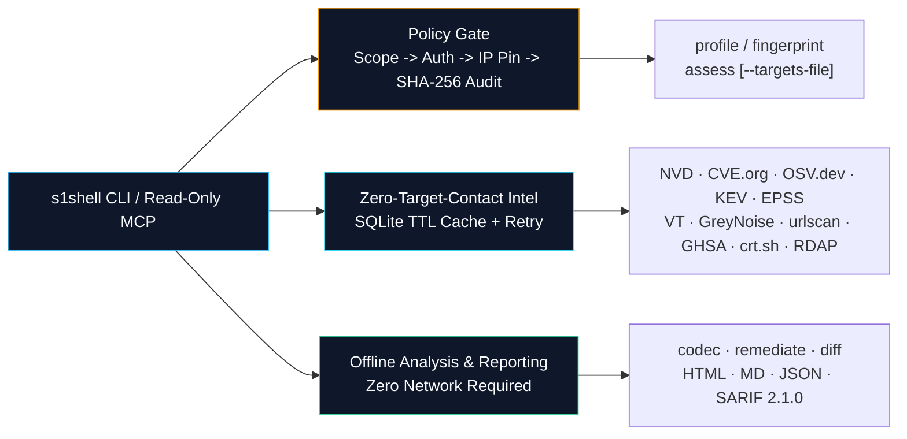
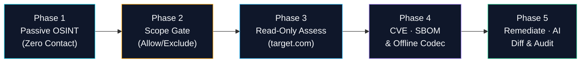

<a id="top"></a>

<div align="center">


<br />
<br />

[](CHANGELOG.md)
[](pyproject.toml)
[](scripts/install-kali.sh)
[](LICENSE)
[](.github/workflows/ci.yml)
[](#read-only-offline-mcp-server-s1shell-mcp-serve)

<br />

**Open-source defensive security assessment, passive OSINT, SBOM auditing, and reporting CLI built for Kali Linux & Linux.**

[⚡ Setup & Install](#part-1-setup--configuration) &nbsp;·&nbsp;
[🔑 API Keys & Logins](#13-configure-optional-api-keys--ai-provider-env-atomic-0600) &nbsp;·&nbsp;
[🎯 Pentesting Guide (`target.com`)](#part-2-pentesting--assessment-guide-example-httpswwwtargetcom) &nbsp;·&nbsp;
[🤖 MCP Server](#read-only-offline-mcp-server-s1shell-mcp-serve) &nbsp;·&nbsp;
[📖 CLI Reference](#part-3-reference-cicd--troubleshooting)

</div>

---

## Architecture Overview



---

## Key Capabilities

<table>
  <tr>
    <td width="50%" valign="top">
      <h3>🛡️ Fail-Closed Scope &amp; Governance</h3>
      Allow/deny (<code>--exclude</code>) rules, bulk import (<code>--dry-run</code>), DNS rebinding + private/CGNAT (<code>100.64.0.0/10</code>)/NAT64 (<code>64:ff9b::/96</code>)/IPv4-mapped IPv6/metadata guards, IP-pinned HTTP/TLS, atomic <code>0600</code> writes, and a file-locked (<code>fcntl.flock</code>) <code>O(1)</code> SHA-256 hash-chained <code>audit.log</code>.
    </td>
    <td width="50%" valign="top">
      <h3>🔍 Deep Read-Only Target Profiling</h3>
      Recursive RFC 7208 <code>SPF</code> + void/loop checks, <code>DMARC</code>/<code>MTA-STS</code>/<code>TLS-RPT</code>/<code>BIMI</code>/<code>DANE TLSA</code>/<code>DNSSEC</code>/dangling CNAME, full X.509 cert chains + CAA alignment + TLS 1.0–1.3 matrix + SPKI pin, CSP v2/CORS/HSTS/cookies, passive HTML secret/JWT/source-map/stack-trace checks, plus opt-in <code>OPTIONS</code> &amp; OIDC/JWKS well-known audits.
    </td>
  </tr>
  <tr>
    <td width="50%" valign="top">
      <h3>🧬 81 Passive Fingerprints &amp; Offline EOL DB</h3>
      Identifies web servers, CDNs, WAFs, DevOps platforms, frameworks, and client-side JS libraries (<code>jQuery</code>, <code>Bootstrap</code>, <code>Lodash</code>, <code>Moment.js</code>, <code>DOMPurify</code>, <code>Handlebars</code>, <code>Axios</code>, <code>Swagger UI</code>) with CPE 2.3 correlation, offline <b>End-of-Life (<code>EOL-001</code>)</b> detection, and custom <code>~/.s1shell/signatures.d/*.yaml</code> rules.
    </td>
    <td width="50%" valign="top">
      <h3>📦 CVE, KEV, EPSS, GHSA &amp; 14-Format SBOM Audit</h3>
      NVD 2.0 + CVE.org + GHSA + CISA KEV + FIRST EPSS with SSVC <code>P0-IMMEDIATE</code>..<code>P3-MONITOR</code> tiers &amp; pure-Python CVSS v3.1 scoring, plus recursive zero-contact <b>OSV.dev</b> lockfile &amp; CycloneDX / <b>SPDX 2.3</b> SBOM auditing with semantic highest-version upgrade commands.
    </td>
  </tr>
  <tr>
    <td width="50%" valign="top">
      <h3>🌐 7-Feed Passive Threat Intel &amp; OSINT</h3>
      Cached, zero-target-contact lookups with bounded HTTP <code>429</code>/<code>502</code>/<code>503</code>/<code>504</code> <code>Retry-After</code> backoff across <b>VirusTotal v3</b>, <b>GreyNoise Community</b>, <b>urlscan.io Search</b>, <b>GHSA</b>, <b>NVD</b>, plus zero-API-key <b>Certificate Transparency (<code>crt.sh</code>)</b> and <b>RDAP</b>.
    </td>
    <td width="50%" valign="top">
      <h3>🔧 Playbooks, Presets, Drift Diffs &amp; SARIF</h3>
      Posture presets (<code>web</code>, <code>api</code>, <code>strict</code>), transparent waivers (<code>--ignore-finding</code>), OWASP Top 10:2021 / ASVS / CWE / NIST 800-53 mapping, offline config snippets (<code>nginx</code>, <code>apache</code>, <code>caddy</code>, <code>express</code>, <code>dns</code>, <code>security.txt</code>), <code>diff --fail-on-regression</code>, and CI gates (<code>exit 4</code>).
    </td>
  </tr>
  <tr>
    <td width="50%" valign="top">
      <h3>🧪 Offline CyberChef-Style Codec &amp; Inspector</h3>
      Zero-network <code>s1shell codec decode|encode|inspect|hash</code> across 25 codecs (Base64/32/58/85, Hex, URL, HTML, Unicode, Punycode, ROT13/Caesar, Gzip/Zlib/Deflate, SAML XML, JWT, auto magic peeling), X.509 PEM/DER inspection, hash ID, and Shannon entropy.
    </td>
    <td width="50%" valign="top">
      <h3>🤖 Multi-Provider Defensive AI &amp; 19-Tool MCP</h3>
      Supports air-gapped local <b>Ollama</b>, <b>Anthropic</b>, <b>OpenAI-compatible</b>, and <b>Google Gemini</b> with <code>&lt;untrusted_telemetry&gt;</code> isolation &amp; reversible NDA redaction (<code>--redact</code> for IPv4/IPv6, hosts, cookies, auth/API-key headers, query secrets, &amp; JWTs), plus a 19-tool read-only stdio MCP server.
    </td>
  </tr>
</table>

---

## Authorized-Use Notice & Policy Boundaries

> [!CAUTION]
> **Authorized Use Only:** S1shell is strictly intended for systems you **own** or have **explicit written authorization** to evaluate. Every target-touching operation enforces a mandatory **fail-closed policy gate**:
>
> 1. **Scope First (`exit 2`):** No packet is sent unless the target and its resolved IPs match an active, unexpired allow rule (and no `--exclude` rule, including IPv4-mapped IPv6/NAT64 unwrapping) in `~/.s1shell/scope.yaml`, blocking un-scoped loopback, private, CGNAT (`100.64.0.0/10`), NAT64 (`64:ff9b::/96`), and cloud metadata IPs.
> 2. **Explicit Authorization (`exit 3`):** Requires `--authorized` or interactive TTY confirmation; non-interactive runs without `--authorized` fail immediately.
> 3. **Tamper-Evident Audit Logging:** Every network attempt appends a file-locked (`fcntl.flock`), SHA-256 hash-chained JSONL record to `~/.s1shell/audit.log` (`0600`), verifiable offline via `s1shell audit verify`.

### What S1shell Does Not Do

By design, S1shell **never** implements or accepts plugins for:

- Exploitation, exploit payloads, or vulnerability PoC execution
- Payload generation or active vulnerability probing/fuzzing (SQLi/XSS/SSRF/LFI strings)
- WAF bypass, firewall evasion, request smuggling, or browser User-Agent spoofing
- Rate-limit evasion, proxy rotation, or IP rotation
- Brute force, password spraying, credential testing, or directory/subdomain enumeration
- Port scanning, host discovery, denial-of-service testing, or target state modification

---

## Part 1: Setup & Configuration

Complete these steps **once** on your Kali Linux or Linux workstation before starting an engagement.

### 1.1 Install S1shell

```bash
git clone https://github.com/willygailo/ProjectPY.git
cd ProjectPY
```

<table>
  <tr>
    <th width="33%">🐉 Option A — Kali Linux (Recommended)</th>
    <th width="34%">📦 Option B — Standard Linux (<code>pipx</code>)</th>
    <th width="33%">🛠️ Option C — Contributor / Dev</th>
  </tr>
  <tr>
    <td valign="top">
      Checks Python <code>3.10+</code>, installs apt prerequisites (<code>python3-venv</code>, <code>python3-pip</code>, <code>pipx</code>), installs <code>s1shell</code> globally (or <code>.venv</code> with <code>--dev</code>), and runs <code>s1shell doctor</code>:
      <br /><br />
      <pre><code>./scripts/install-kali.sh
# Editable dev venv:
./scripts/install-kali.sh --dev</code></pre>
    </td>
    <td valign="top">
      Installs <code>s1shell</code> in an isolated <code>pipx</code> environment on your <code>PATH</code>:
      <br /><br />
      <pre><code>pipx ensurepath
pipx install .

# Auto-reflect local edits

pipx install --editable --force .</code></pre>
    </td>
    <td valign="top">
      Creates local <code>.venv</code> and runs the full offline lint, strict typecheck, and 90-test suite:
      <br /><br />
      <pre><code>make setup
source .venv/bin/activate
make check</code></pre>
    </td>
  </tr>
</table>

> [!TIP]
> **Seeing `zsh: command not found: s1shell` or `bash: s1shell: command not found`?**
>
> 1. Install the CLI first (`./scripts/install-kali.sh` or `pipx install --editable --force .`).
> 2. Ensure `~/.local/bin` is on your `PATH`, then refresh your shell command cache:
>
>    ```bash
>    export PATH="$HOME/.local/bin:$PATH"
>    rehash          # zsh (or `hash -r` in bash)
>    which s1shell   # expected: ~/.local/bin/s1shell
>    ```
>
> 3. Or run straight from source with zero installation: `PYTHONPATH=src python3 -m s1shell doctor`

### 1.2 Verify Your Setup

```bash
s1shell --version       # expected: s1shell 0.4.2
s1shell doctor          # expected: healthy=True, 81 passive fingerprint signatures
s1shell audit verify    # expected: Audit Log Integrity: VALID
```

> [!NOTE]
> If `s1shell doctor` shows `WARN` on `anthropic_api_key`, verify your `.env` contains a standard `sk-ant-api*` inference key (not an `sk-ant-admin*` admin key) — or switch to local air-gapped Ollama via `s1shell ai env --provider ollama`.

### 1.3 Configure Optional API Keys & AI Provider (`.env`, Atomic `0600`)

All API keys are **optional** — S1shell works out of the box with unauthenticated NVD, CVE.org, OSV.dev, `crt.sh`, and RDAP. Keys are written atomically with `0600` permissions (gitignored and always masked in output) and resolve in order: **process environment → project `./.env` → `~/.s1shell/.env`** (see [.env.example](.env.example)).

#### Step 1 — Log In & Get Your API Keys / Tokens

| Service | CLI Flag / Env Variable | Where to Log In & Get Key | Purpose |
| --- | --- | --- | --- |
| **NVD (NIST)** | `--set-nvd-key` / `NVD_API_KEY` | [Request NVD API Key](https://nvd.nist.gov/developers/request-an-api-key) | Raises NVD 2.0 quota from 5 req/30s to 50 req/30s |
| **GitHub (GHSA)** | `--set-github-key` / `GITHUB_TOKEN` | [GitHub Personal Access Tokens](https://github.com/settings/tokens) | Authenticates GitHub Security Advisories & CVE enrichment |
| **VirusTotal v3** | `--set-vt-key` / `VIRUSTOTAL_API_KEY` | [Sign Up](https://www.virustotal.com/gui/join-us) · [My API Key](https://www.virustotal.com/gui/my-apikey) | Passive domain/IP reputation lookups |
| **GreyNoise Community** | `--set-greynoise-key` / `GREYNOISE_API_KEY` | [Sign Up](https://viz.greynoise.io/signup) · [Account API Key](https://viz.greynoise.io/account/api-key) | Passive IP scanner noise & benign RIOT lookup |
| **urlscan.io** | `--set-urlscan-key` / `URLSCAN_API_KEY` | [Sign Up](https://urlscan.io/signup) · [Settings & API](https://urlscan.io/user/#settings) | Strictly passive historical Search API index lookup |
| **Ollama (Local AI)** | `--provider ollama` | [Download Ollama](https://ollama.com/download) *(no account / no key needed)* | Air-gapped local LLM triage with zero cloud telemetry |
| **Anthropic Claude** | `--provider anthropic` / `ANTHROPIC_API_KEY` | [Anthropic Console Keys](https://console.anthropic.com/settings/keys) *(use `sk-ant-api*`, not `sk-ant-admin*`)* | Cloud defensive AI triage & remediation |
| **OpenAI-Compatible** | `--provider openai_compat` / `OPENAI_API_KEY` | [OpenAI API Keys](https://platform.openai.com/api-keys) | OpenAI, OpenRouter, LiteLLM, or vLLM inference |
| **Google Gemini** | `--provider gemini` / `GEMINI_API_KEY` | [Google AI Studio API Keys](https://aistudio.google.com/apikey) | Google Gemini defensive AI inference |
| **State Directory** | `S1SHELL_HOME` | Local path override *(default `~/.s1shell`)* | Stores `scope.yaml`, `audit.log`, `cache.db`, & `.env` |

#### Step 2 — Save Keys via CLI (`0600`)

```bash
# Save passive threat-intelligence & CVE quota keys (pass only the keys you have)
s1shell intel env \
  --set-nvd-key "YOUR_NVD_KEY" \
  --set-github-key "YOUR_GITHUB_TOKEN" \
  --set-vt-key "YOUR_VT_KEY" \
  --set-greynoise-key "YOUR_GREYNOISE_KEY" \
  --set-urlscan-key "YOUR_URLSCAN_KEY"

# Verify masked threat-intel key status
s1shell intel env

# Configure local air-gapped Ollama (zero cloud telemetry):
s1shell ai env --provider ollama --model "llama3.1:8b"

# Or configure a cloud AI provider (Anthropic / OpenAI-compatible / Gemini):
# s1shell ai env --provider anthropic --set-key "sk-ant-api03-..." --model "claude-sonnet-4-20250514"
# s1shell ai env --provider openai_compat --set-key "sk-..." --model "gpt-4o-mini"
# s1shell ai env --provider gemini --set-key "AIza..." --model "gemini-2.5-flash"
```

### 1.4 Optional Setup (Shell Completion, Custom Signatures & MCP Server)

<details>
<summary><b>⌨️ Shell Tab-Completion (bash, zsh, fish)</b></summary>

```bash
# Bash
mkdir -p ~/.local/share/bash-completion/completions
s1shell completion bash > ~/.local/share/bash-completion/completions/s1shell

# Zsh
mkdir -p ~/.zsh/completions
s1shell completion zsh > ~/.zsh/completions/_s1shell

# Fish
mkdir -p ~/.config/fish/completions
s1shell completion fish > ~/.config/fish/completions/s1shell.fish
```

</details>

<details>
<summary><b>🧩 Custom Passive Fingerprint Signatures (<code>~/.s1shell/signatures.d/</code>)</b></summary>

Drop any `*.yaml` file into `~/.s1shell/signatures.d/` to extend S1shell's 81 bundled passive rules without editing source code:

```yaml
signatures:
  - vendor: "Internal Corp"
    product: "Custom Edge Gateway"
    category: "waf"
    confidence: "high"
    headers:
      - name: "x-corp-edge"
        pattern: "^edge/([\\d.]+)"
```

</details>

<a id="read-only-offline-mcp-server-s1shell-mcp-serve"></a>
<details open>
<summary><b>🤖 Read-Only Offline MCP Server (<code>s1shell mcp serve</code> — 19 Tools)</b></summary>

Exposes **19 strictly read-only offline/intel tools** over JSON-RPC 2.0 stdio with zero target-touching capability:

| Group | Exposed MCP Tools |
| --- | --- |
| **Governance & Audit** | `s1shell_doctor`, `s1shell_scope_list`, `s1shell_scope_check`, `s1shell_audit_list`, `s1shell_audit_verify` |
| **CVE & Supply Chain** | `s1shell_cve_search`, `s1shell_cve_get` (single `cve_id` or batch `cve_ids`), `s1shell_cve_audit` (14 lockfile/SBOM formats + `recursive`) |
| **Passive Intel & OSINT** | `s1shell_intel_lookup` (VT, GreyNoise, urlscan.io Search, RDAP), `s1shell_intel_advisory` (GHSA), `s1shell_intel_ct` (`crt.sh`), `s1shell_intel_rdap` |
| **Offline Analysis & Codec** | `s1shell_fingerprint_from_profile`, `s1shell_assess_diff`, `s1shell_remediate`, `s1shell_codec_decode`, `s1shell_codec_encode`, `s1shell_codec_inspect`, `s1shell_codec_hash` |

```json
{
  "mcpServers": {
    "s1shell": {
      "command": "s1shell",
      "args": ["mcp", "serve"]
    }
  }
}
```

</details>

---

## Part 2: Pentesting & Assessment Guide (Example: `https://www.target.com`)



### ⚡ Quick 4-Command Engagement Flow (TL;DR)

Every authorized target engagement follows the same 4-step loop: **Add Scope → Verify Scope → Assess → Remediate**:

```bash
# 1. Authorize the target in ~/.s1shell/scope.yaml (required before any target packet is sent)
s1shell scope add target.com --include-subdomains \
  --owner "Target Corp" --ref "SOW-2026-014" --expires 2026-12-31

# 2. Verify DNS & scope match (expected output: [IN SCOPE])
s1shell scope check https://www.target.com

# 3. Run the read-only assessment and save HTML / MD / SARIF / JSON reports
s1shell assess https://www.target.com --authorized \
  --enrich-cve --intel --well-known --check-methods \
  --operator "Jane Doe" --out-dir ./results/target-com

# 4. Generate copy-paste server/DNS hardening configs and open report.html
s1shell remediate ./results/target-com/assess.json --stack auto --out ./results/target-com/hardening.md
```

<details>
<summary><b>📺 Example Terminal Output Preview</b></summary>

```text
[IN SCOPE] target=https://www.target.com resolved_ips=[93.184.216.34] — Authorized by scope entry '7c715dbe' (SOW-2026-014).

Assessment Posture Summary: https://www.target.com/ (93.184.216.34)
┏━━━━━━━━━━━━━━━━━┳━━━━━━━━━━━━━━━━━━━━━━━━━━━━━━━━━━━━━━━━━━━━━━━━━━━━━━━━━━━━┓
┃ Metric          ┃ Value                                                      ┃
┡━━━━━━━━━━━━━━━━━╇━━━━━━━━━━━━━━━━━━━━━━━━━━━━━━━━━━━━━━━━━━━━━━━━━━━━━━━━━━━━┩
│ Scope Ref       │ SOW-2026-014 (7c715dbe) | preset=web                       │
│ Posture Score   │ 74/100 (Grade C | Risk MEDIUM)                             │
│ Findings        │ CRITICAL=0, HIGH=1, MEDIUM=3, LOW=4, INFO=2                │
│ Detected Stack  │ nginx 1.24.0, Cloudflare, jQuery 3.5.1                     │
│ Correlated CVEs │ 2 (KEV=0, P1-URGENT=1)                                     │
│ Saved Bundle    │ report.html, report.md, report.sarif, assess.json, ...     │
└─────────────────┴────────────────────────────────────────────────────────────┘
```

</details>

### Command Modes at a Glance

| Mode | Scope & `--authorized` Required? | Commands |
| --- | --- | --- |
| **Zero-Target-Contact (Passive / Offline)** | No — never sends packets to `target.com` | `intel ct\|rdap\|lookup\|advisory`, `cve search\|get\|audit`, `codec decode\|encode\|inspect\|hash`, `fingerprint --from-profile`, `remediate`, `diff`, `report build`, `audit` |
| **Authorized Target Mode (Read-Only)** | **Yes** — must match `scope.yaml` + `--authorized` | `assess <target \| --targets-file>`, `profile <target>`, `fingerprint <target>` |

> [!TIP]
> **Want to practice safely on localhost first?** Authorize `127.0.0.1` (`s1shell scope add 127.0.0.1 --owner "Lab" --ref "LAB-1" --expires 2027-12-31`) and run `s1shell assess http://127.0.0.1:<port> --authorized --skip-cve --out-dir ./results/lab` against your own local test server.

---

### Phase 1 — Pre-Engagement Passive OSINT (Zero Target Contact)

Gather passive infrastructure, certificate SANs, domain registration, and reputation telemetry before touching `https://www.target.com` (cached in `~/.s1shell/cache.db` with automatic retry/backoff on HTTP `429`/`502`/`503`/`504`):

```bash
# 1. Enumerate Certificate Transparency SANs passively (zero API key) and export review candidates
s1shell intel ct target.com --export-candidates ./target-candidates.txt

# 2. Inspect domain registration, registrar lock, DNSSEC delegation, & expiry via RDAP (zero API key)
s1shell intel rdap target.com

# 3. Query passive VirusTotal, urlscan.io Search, GreyNoise, & RDAP reputation
s1shell intel lookup www.target.com --sources vt,urlscan,rdap
s1shell intel lookup 93.184.216.34 --sources vt,greynoise,rdap
```

---

### Phase 2 — Scope Onboarding & Pre-Flight Gate

Onboard your authorized SOW hosts and deny-first exclusions (`--exclude`), then confirm DNS + scope status before any packet is sent:

```bash
# Add authorized domain (supports domain, *.domain, IP, CIDR, or URL prefix)
s1shell scope add target.com --include-subdomains \
  --owner "Target Corp" --ref "SOW-2026-014" --expires 2026-12-31 \
  --notes "Q4 authorized web posture assessment"

# Explicitly exclude out-of-scope subdomains or sensitive IPs (deny-first precedence)
s1shell scope add payments.target.com --exclude \
  --owner "Target Corp" --ref "SOW-2026-014" --expires 2026-12-31

# Pre-flight verification (checks scope.yaml rules + DNS anti-escape without sending HTTP/TLS packets)
s1shell scope check https://www.target.com
s1shell scope check https://payments.target.com   # -> exit 2 (excluded)
```

<details>
<summary><b>📄 Bulk Scope Import for Multi-Host Engagements (<code>scope import --dry-run</code>)</b></summary>

Create a reviewed `target-scope.txt` (`#` for comments, `!` prefix for exclusions):

```text
# Authorized hosts from SOW-2026-014
www.target.com
api.target.com
!payments.target.com
```

Validate with `--dry-run`, then import:

```bash
s1shell scope import target-scope.txt \
  --owner "Target Corp" --ref "SOW-2026-014" --expires 2026-12-31 --dry-run

s1shell scope import target-scope.txt \
  --owner "Target Corp" --ref "SOW-2026-014" --expires 2026-12-31
```

</details>

---

### Phase 3 — Scoped Read-Only Target Assessment (`https://www.target.com`)

#### 3.1 All-in-One Web Assessment

Runs **profile → passive fingerprint & EOL → CPE-verified CVE + KEV/EPSS → passive threat intel → posture scoring (CWE/ASVS/OWASP/NIST) → offline hardening playbook → full report bundle**:

```bash
s1shell assess https://www.target.com --authorized \
  --enrich-cve --intel --well-known --check-methods \
  --operator "Jane Doe" --out-dir ./results/target-com
```

```text
results/target-com/
├── report.html        # Self-contained autoescaped executive & technical HTML report
├── report.md          # Markdown report ready for Jira tickets, wikis, or PRs
├── report.sarif       # SARIF 2.1.0 findings for GitHub Code Scanning / VS Code
├── assess.json        # Master artifact consumed by `remediate`, `diff`, & `ai analyze`
├── profile.json       # Raw DNS, TLS chain, HTTP headers, cookies, well-known, & passive HTML
├── fingerprint.json   # Detected server, CDN, WAF, framework, JS library CPEs, & EOL flags
├── cves.json          # Matched CVEs with KEV, EPSS, GHSA, & SSVC priority tiers
└── intel.json         # Passive VirusTotal, GreyNoise, urlscan.io Search, & RDAP context
```

#### 3.2 API Preset, Multi-Target Batch & Standalone Profiling

```bash
# API preset (suppresses browser HTML/clickjacking noise) with waiver & CI thresholds (exit 4)
s1shell assess https://api.target.com --authorized \
  --preset api --check-methods --ignore-finding DNS-005 \
  --fail-on HIGH --min-score 80 --format sarif --out ./results/api-target.sarif

# Sequential guarded batch assessment (concurrency=1, scope-gated per target, HTML dashboard)
s1shell assess --targets-file target-urls.txt --authorized \
  --delay 0.5 --enrich-cve --intel --fail-on CRITICAL --out-dir ./results/target-batch

# Standalone granular profile + zero-network offline fingerprinting
s1shell profile https://www.target.com --authorized \
  --tls-versions --dns-security --well-known --check-methods \
  --format json --out ./results/profile.json
s1shell fingerprint --from-profile ./results/profile.json \
  --format json --out ./results/fp.json
```

---

### Phase 4 — CVE Triage, SBOM Auditing & Offline Token/Codec Analysis

All Phase 4 commands are **zero-target-contact** (offline or public vulnerability feeds only).

#### 4.1 Correlate Stack Fingerprints to CVEs, KEV, EPSS & GHSA

```bash
# Correlate detected stack components from Phase 3 with CISA KEV & FIRST EPSS priority tiers
s1shell cve search --from-fingerprint ./results/target-com/fingerprint.json --enrich
s1shell cve search --from-fingerprint ./results/target-com/fingerprint.json --kev-only

# Targeted research by product keyword or specific CVE IDs (NVD + CVE.org + GHSA + KEV/EPSS)
s1shell cve search --keyword "nginx 1.18" --min-cvss 7.0 --enrich
s1shell cve get CVE-2021-23017 CVE-2023-44487 --enrich

# Query GitHub Security Advisories directly
s1shell intel advisory --cve CVE-2023-45803
s1shell intel advisory --ecosystem pip --package requests
```

#### 4.2 Audit Client Repositories, Lockfiles & SBOMs (14 Formats)

Scans `requirements.txt`, `uv.lock`, `poetry.lock`, `Pipfile.lock`, `package-lock.json`, `yarn.lock`, `pnpm-lock.yaml`, `go.mod`, `Cargo.lock`, `composer.lock`, `Gemfile.lock`, `pom.xml`, **CycloneDX**, and **SPDX 2.3** SBOMs via **OSV.dev + pure-Python CVSS v3.1 + KEV/EPSS**, generating highest-version semantic upgrade commands:

```bash
s1shell cve audit requirements.txt --enrich --fail-on HIGH
s1shell cve audit ./target-repo --recursive --enrich --format sarif --out ./results/deps.sarif
s1shell cve audit sbom.spdx.json --enrich --kev-only
```

#### 4.3 Offline Decoding, Token/Cert Inspection & Hashing (`s1shell codec`)

```bash
# Magic auto-decode (default `-e auto` peels nested URL -> Base64 -> Gzip -> JSON)
s1shell codec decode "SGVsbG8gUzFzaGVsbCE="
s1shell codec decode "48:65:6c:6c:6f" -e hex --raw
s1shell codec decode "Uryyb" -e caesar --all-shifts
s1shell codec decode "eJz..." --chain url,base64,zlib

# Pipe from stdin (`-`) or encode with chained pipelines
echo "48656c6c6f" | s1shell codec decode - -e hex --raw
s1shell codec encode "Hello S1shell" --chain gzip,base64url --raw

# Smart offline inspector (JWT hygiene, X.509 PEM/DER, hash ID, Unix epoch, entropy, auto-decode)
s1shell codec inspect "5d41402abc4b2a76b9719d911017c592"
s1shell codec inspect --file ./results/target-com/server.pem

# Compute evidence hashes & Shannon entropy
s1shell codec hash --file ./results/target-com/report.html
```

<details>
<summary><b>🔤 Supported Offline Codecs Table (25 Codecs + Magic Auto)</b></summary>

| Codec Group | Supported Names / Aliases | Highlights |
| --- | --- | --- |
| **Base-N** | `base64` (`b64`), `base64url` (`b64url`), `base32` (`b32`), `base58` (`b58`), `base85` (`b85`), `ascii85` (`a85`) | Auto-padding & whitespace-tolerant decoding |
| **Hex & Numeric** | `hex` (`b16`), `hex-escaped`, `binary` (`bin`), `octal` (`oct`), `decimal` (`dec`) | Accepts `0x`, colons `aa:bb`, spaces, & `\x41` |
| **Web & Text** | `url` (`percent`), `url-all`, `html`, `unicode`, `quoted-printable` (`qp`), `punycode` (`idna`) | Multi-layer URL/HTML/Unicode & `xn--` homograph decode |
| **Compression & Auth** | `gzip`, `zlib`, `deflate`, `gzip-b64`, `zlib-b64`, `saml`, `jwt` | 8 MiB zip-bomb cap; SAML XML pretty-print; JWT UTC & hygiene checks |
| **Classic & Magic** | `rot13`, `caesar` (`--shift`, `--all-shifts`), `morse`, `auto` (`--max-depth`) | Recursive magic peeling with step-by-step trace |

</details>

---

### Phase 5 — Remediation Playbooks, Redacted AI Triage, Reporting & Re-Test Drift

```bash
# 1. Deterministic offline hardening snippets (nginx, apache, caddy, express, dns, security.txt)
s1shell remediate ./results/target-com/assess.json \
  --stack auto --format md --out ./results/target-com/hardening.md

# 2. Optional NDA-safe AI triage (redacts hostnames, IPv4/IPv6, emails, cookies, auth headers, query secrets & JWTs)
s1shell ai analyze \
  --input ./results/target-com/assess.json \
  --mode remediate --redact --format md --out ./results/target-com/ai_remediation.md

# 3. Compile custom combined executive HTML report from individual JSON artifacts
s1shell report build \
  --input ./results/target-com/profile.json \
  --input ./results/target-com/fingerprint.json \
  --input ./results/target-com/cves.json \
  --input ./results/target-com/intel.json \
  --operator "Jane Doe" --format html --out ./results/target-com/executive-report.html

# 4. Re-test after client fixes and check for posture regressions (exits 4 on regression)
s1shell assess https://www.target.com --authorized \
  --enrich-cve --intel --well-known --check-methods --out-dir ./results/target-com-retest
s1shell diff \
  ./results/target-com/assess.json \
  ./results/target-com-retest/assess.json \
  --fail-on-regression

# 5. Verify chain-of-custody tamper-evident audit trail
s1shell audit list --category target --target target.com --limit 50
s1shell audit verify
```

---

## Part 3: Reference, CI/CD & Troubleshooting

### CI/CD & GitHub Code Scanning (SARIF 2.1.0)

```yaml
- name: Run S1shell Dependency & Authorized Target Gate
  run: |
    s1shell cve audit requirements.txt --enrich --format sarif --out deps.sarif --fail-on HIGH
    s1shell assess https://www.target.com --authorized \
      --preset api --fail-on HIGH --min-score 80 --format sarif --out target.sarif

- name: Upload SARIF to GitHub Security Tab
  if: always()
  uses: github/codeql-action/upload-sarif@v3
  with:
    sarif_file: target.sarif
```

### Quick Troubleshooting

| Symptom / Exit Code | Cause | Fix |
| --- | --- | --- |
| `command not found: s1shell` | CLI not installed via `pipx` yet or shell command cache is stale | Run `pipx install --editable --force .` (or `./scripts/install-kali.sh`), ensure `~/.local/bin` is in `$PATH`, then run `rehash` (`zsh`) / `hash -r` (`bash`). Fallback: `PYTHONPATH=src python3 -m s1shell ...` |
| `exit 2` (`OutOfScopeError`) | Target is not in `scope.yaml`, expired, excluded, or resolves to an un-scoped private/loopback/CGNAT/NAT64/metadata IP | Run `s1shell scope list` and `s1shell scope check https://www.target.com`, then add/renew via `s1shell scope add ... --replace` |
| `exit 3` (`UnauthorizedError`) | Running a target command non-interactively without confirmation | Pass `--authorized` explicitly |
| `exit 4` (`PolicyGateError`) | Findings breached `--fail-on`, `--min-score`, or `--fail-on-regression` | Expected CI/CD gate failure — review findings or adjust thresholds / `--ignore-finding <ID>` |
| Intel/AI feed skipped or rate-limited | Missing or misconfigured API key in `.env` | Run `s1shell doctor` and `s1shell intel env` / `s1shell ai env` to check masked key status |

### Command, Flag & Exit-Code Reference

<details open>
<summary><b>📋 Modules &amp; Commands (15 Modules)</b></summary>

| Command | Network Contact | Purpose |
| --- | --- | --- |
| `s1shell assess <target \| --targets-file>` | Scoped target + NVD/KEV/EPSS (+ optional VT/GN/urlscan/RDAP with `--intel`) | Unified profile, fingerprint, EOL, CVE, intel, posture, playbook, & report bundle |
| `s1shell scope add \| import \| list \| check \| remove \| expire` | DNS on `check` only | Manage authorized allow/exclude rules & bulk imports in `scope.yaml` |
| `s1shell cve search \| get \| audit \| cache clear` | Public NVD / CVE.org / OSV.dev / GHSA / KEV / EPSS | CVE lookup, SSVC priority triage, & recursive lockfile/SBOM auditing |
| `s1shell intel env \| lookup \| advisory \| ct \| rdap` | Public VT / GreyNoise / urlscan Search / GHSA / crt.sh / RDAP | Zero-target-contact passive threat intel, CT logs, RDAP, & `.env` key manager |
| `s1shell codec decode \| encode \| inspect \| hash` | None (offline) | Offline Base64/Hex/URL/SAML/JWT/X.509/Gzip/Auto decoder, encoder, inspector, & hashes |
| `s1shell profile <target>` | Single target (1 GET + TLS + opt-in checks) | Recursive SPF/DNS, TLS chain/SPKI/CAA, CSP v2, passive leaks/JWT, OIDC/JWKS, `OPTIONS` |
| `s1shell fingerprint [<target> \| --from-profile FILE]` | None (`--from-profile`) or 1 GET | Passive server/CDN/WAF/JS-library identification with CPE 2.3 & offline EOL flags |
| `s1shell remediate <assess.json>` | None (offline) | Deterministic stack-tailored hardening config generator |
| `s1shell diff <base.json> <curr.json>` | None (offline) | Security posture drift detection & CI regression gate |
| `s1shell report build` | None (offline) | Compile artifacts into JSON, Markdown, SARIF 2.1.0, or HTML |
| `s1shell ai env \| analyze` | Configured AI endpoint (or local Ollama) | Manage `.env` credentials & redacted defensive AI analysis |
| `s1shell audit list \| verify` | None (offline) | Inspect & verify SHA-256 hash chain integrity of `audit.log` |
| `s1shell mcp serve` | Offline / public intel only | Stdio JSON-RPC 2.0 MCP server exposing 19 strictly read-only tools |
| `s1shell doctor` / `s1shell completion {bash,zsh,fish}` | None (offline) | Local environment diagnostics & shell tab-completion |

</details>

<details>
<summary><b>⚙️ Common Global Flags &amp; Exit Codes</b></summary>

#### Common Global Flags (Accepted Before or After Subcommands)

| Flag | Description |
| --- | --- |
| `--format {table,json,md,html,sarif}` | Output format (`html` on `report build` / `assess`; `sarif` on `report build` / `assess` / `cve audit`) |
| `--out FILE` | Write output to `FILE` instead of stdout |
| `--authorized` | Non-interactive authorization confirmation for target-touching commands |
| `--scope-file FILE` | Override path to `scope.yaml` |
| `--home DIR` | Override state directory (default `~/.s1shell` or `$S1SHELL_HOME`) |
| `--no-color` | Disable ANSI colors in terminal tables |
| `--verbose` | Print full tracebacks to stderr on unexpected errors |
| `--version` | Show installed `s1shell` version |

#### Exit Codes

| Code | Meaning |
| --- | --- |
| `0` | Success |
| `1` | Validation, network, or runtime error |
| `2` | Target out of scope, excluded, expired, or unsafe IP resolution |
| `3` | Operator authorization not confirmed |
| `4` | CI policy gate threshold breached (`--fail-on`, `--min-score`, `--fail-on-regression`) |

</details>

---

<div align="center">

### Documentation

[Architecture](docs/architecture.md) &nbsp;·&nbsp;
[Artifact & Log Schemas](docs/schemas.md) &nbsp;·&nbsp;
[Changelog](CHANGELOG.md) &nbsp;·&nbsp;
[Contributing](CONTRIBUTING.md) &nbsp;·&nbsp;
[Code of Conduct](CODE_OF_CONDUCT.md) &nbsp;·&nbsp;
[Security Policy](SECURITY.md)

<br />

<sub>Built with care for authorized defensive security assessments · MIT License · <a href="#top">↑ Back to Top</a></sub>

</div>
