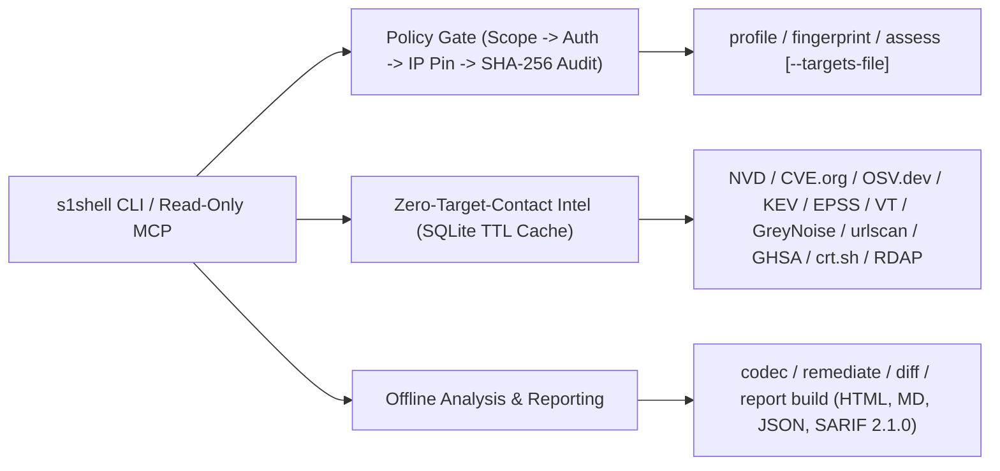

# S1shell

[](CHANGELOG.md)
[](pyproject.toml)
[](LICENSE)
[](.github/workflows/ci.yml)

**S1shell** is an open-source, defensive security assessment CLI toolkit built for Kali Linux and standard Linux environments. It unifies **scoped read-only target profiling**, **passive technology & EOL fingerprinting**, **CVE / KEV / EPSS & multi-ecosystem SBOM auditing**, **7-feed passive threat intelligence & OSINT (`crt.sh` / RDAP)**, **offline CyberChef-style codec & token inspection**, **deterministic hardening playbooks**, **posture drift diffing**, **multi-provider defensive AI triage**, **SARIF / HTML / Markdown reporting**, and a **17-tool read-only offline MCP server** behind a fail-closed authorization gate.

### Key Capabilities

- **Fail-Closed Scope & Governance**: Allow/deny (`--exclude`) scope rules, bulk scope import (`scope import --dry-run`), DNS rebinding & private/metadata IP guards, IP-pinned HTTP/TLS connections, and a SHA-256 hash-chained `audit.log` (`audit verify`).
- **Deep Read-Only Profiling**: DNS hygiene (`A`/`AAAA`/`CNAME`/`MX`/`NS`/`CAA`/recursive RFC 7208 `SPF` + void lookup & loop check/`DMARC`/`MTA-STS`/`TLS-RPT`/`BIMI`/`DANE TLSA`/`DNSSEC`/dangling CNAME + expanded PSL zone-apex fallback), full X.509 certificate chain + CAA-vs-Issuer alignment + TLS 1.0–1.3 matrix/SPKI pin hash, directive-level CSP v2/CORS/HSTS/cache/debug-header/cookie analysis, zero-extra-packet passive HTML inspection (redacted secret/JWT/source-map/stack-trace detection), and opt-in `OPTIONS` method & RFC well-known (`security.txt`, `robots.txt`, OIDC `openid-configuration`, `jwks.json`, mobile trust) review.
- **81 Passive Fingerprints, Client Library CPEs & Offline EOL DB**: Identifies web servers, CDNs, WAFs, DevOps platforms, frameworks, and client-side JS libraries (`jQuery`, `Bootstrap`, `Lodash`, `Moment.js`, `DOMPurify`, `Handlebars`, `Axios`, `Swagger UI`) with automatic CPE 2.3 correlation, offline **End-of-Life (`EOL-001`)** flagging, and custom `~/.s1shell/signatures.d/*.yaml` support.
- **CVE, KEV, EPSS, GHSA & Multi-Ecosystem SBOM Auditing**: NVD 2.0 + CVE.org + GitHub Security Advisories + CISA KEV + FIRST EPSS with SSVC-style `P0-IMMEDIATE`..`P3-MONITOR` tiers and pure-Python **CVSS v3.1 vector scoring**, plus recursive zero-target-contact **OSV.dev** lockfile & SBOM scanning (`requirements.txt`, `uv.lock`, `poetry.lock`, `Pipfile.lock`, `package-lock.json`, `yarn.lock`, `pnpm-lock.yaml`, `go.mod`, `Cargo.lock`, `composer.lock`, `Gemfile.lock`, `pom.xml`, CycloneDX, and **SPDX 2.3**).
- **7-Feed Passive Threat Intel & OSINT (`s1shell intel`)**: Cached, zero-target-contact lookups across **VirusTotal v3**, **GreyNoise Community**, **urlscan.io Search API**, **GitHub Advisories (GHSA)**, **NVD**, plus zero-API-key **Certificate Transparency (`crt.sh`)** and **RFC 7480–7484 RDAP** domain/IP registration intelligence.
- **Deterministic Playbooks, Presets, Drift Diffs & SARIF**: Assessment presets (`web`, `api`, `strict`), transparent finding waivers (`--ignore-finding`), OWASP Top 10:2021 / ASVS / CWE / NIST 800-53 mapping, offline config snippets (`nginx`, `apache`, `caddy`, `express`, `dns`, `security.txt`), `diff --fail-on-regression`, and CI policy gates (`exit 4`).
- **Multi-Provider Defensive AI, Offline Codec & Read-Only MCP**: Supports **Anthropic**, local air-gapped **Ollama**, **OpenAI-compatible**, and **Google Gemini** with prompt-injection tagging (`<untrusted_telemetry>`) and reversible NDA-safe redaction (`--redact`), an offline CyberChef-style **Codec & Token Inspector** (`codec decode|encode|inspect|hash` for Base64/Hex/URL/HTML/Unicode/SAML/JWT/X.509/Gzip/Auto), plus a 17-tool read-only JSON-RPC 2.0 stdio MCP server (`mcp serve`).



---

## Authorized-Use Notice

S1shell is strictly intended for use on systems you **own** or have **explicit written authorization** to evaluate.

Every target-touching operation enforces a fail-closed policy gate:
1. **Scope First (`exit 2`)**: No packet is sent unless the target and its resolved IP addresses match an active, unexpired allow entry (and no `--exclude` rule) in `~/.s1shell/scope.yaml`, and domain entries cannot silently resolve to un-scoped loopback, private, or cloud metadata IPs.
2. **Explicit Authorization (`exit 3`)**: Target commands require `--authorized` or interactive TTY confirmation. Non-interactive runs without `--authorized` fail immediately.
3. **Tamper-Evident Audit Logging**: Every network attempt appends a SHA-256 hash-chained JSONL record to `~/.s1shell/audit.log`, verifiable offline via `s1shell audit verify`.

---

## What S1shell Does Not Do

By design, S1shell **never** implements or accepts plugins for:
- Exploitation, exploit payloads, or vulnerability PoC execution
- Payload generation or active vulnerability probing/fuzzing (SQLi/XSS/SSRF/LFI strings)
- WAF bypass, firewall evasion, request smuggling, or browser User-Agent spoofing
- Rate-limit evasion, proxy rotation, or IP rotation
- Brute force, password spraying, credential testing, or directory/subdomain enumeration
- Port scanning, host discovery, denial-of-service testing, or target state modification

---

## Installation & Shell Completion

### Clone Repository

```bash
git clone https://github.com/willygailo/ProjectPY.git
cd ProjectPY
```

### Kali Linux

```bash
./scripts/install-kali.sh
# Or editable development setup:
./scripts/install-kali.sh --dev
```

### Standard Python (3.10+) with `pipx`

```bash
pipx install .
# Upgrade existing local install after pulling updates:
pipx install --force .
```

### Development & Offline Verification

```bash
make setup
source .venv/bin/activate
make check
```

> Running directly from source without `pipx`? Replace `s1shell` with `PYTHONPATH=src python3 -m s1shell`.

### Shell Tab-Completion (`bash`, `zsh`, `fish`)

```bash
# Bash
mkdir -p ~/.local/share/bash-completion/completions
s1shell completion bash > ~/.local/share/bash-completion/completions/s1shell

# Zsh
mkdir -p ~/.zsh/completions
s1shell completion zsh > ~/.zsh/completions/_s1shell

# Fish
mkdir -p ~/.config/fish/completions
s1shell completion fish > ~/.config/fish/completions/s1shell.fish
```

---

## How to Use S1shell

S1shell commands fall into two clear modes:

| Mode | Scope & `--authorized` Required? | Commands |
|---|---|---|
| **Zero-Target-Contact (Instant)** | No — never sends packets to a target | `doctor`, `cve search\|get\|audit`, `intel env\|lookup\|advisory\|ct\|rdap`, `codec decode\|encode\|inspect\|hash`, `fingerprint --from-profile`, `remediate`, `diff`, `report build`, `audit`, `mcp serve` |
| **Authorized Target Mode** | **Yes** — must match `scope.yaml` + `--authorized` | `profile`, `fingerprint <target>`, `assess <target \| --targets-file>` |

> If you did not install via `pipx`, prefix commands with `PYTHONPATH=src python3 -m s1shell` instead of `s1shell`.

### Recipe 1: Run Your First Authorized Target Assessment (3 Steps)

Every target-touching run follows the same 3-step loop: **Add Scope → Verify Scope → Assess**.

```bash
# 1. Add your authorized target (supports domain, *.domain, IP, CIDR, or URL prefix)
s1shell scope add example.com --include-subdomains \
  --owner "ACME IT" --ref "SOW-2026-014" --expires 2026-12-31 \
  --notes "Quarterly web posture review"

# Optional: add an IP/CIDR or block out-of-scope subdomains with --exclude
s1shell scope add 203.0.113.0/24 --owner "ACME IT" --ref "SOW-2026-014" --expires 2026-12-31
s1shell scope add payments.example.com --exclude --owner "ACME IT" --ref "SOW-2026-014" --expires 2026-12-31

# 2. Confirm DNS resolution and scope status before touching the target
s1shell scope check https://app.example.com

# 3. Run the all-in-one read-only assessment and save the full report bundle
s1shell assess https://app.example.com --authorized \
  --enrich-cve --intel --well-known --check-methods \
  --operator "Jane Doe" --out-dir ./results
```

**What gets generated inside `./results/`:**

```text
results/
├── report.html        # Open in your browser for the full executive & technical report
├── report.md          # Markdown report ready for tickets, wikis, or PRs
├── report.sarif       # SARIF 2.1.0 findings for GitHub Code Scanning / VS Code
├── assess.json        # Master artifact used by `remediate`, `diff`, and `ai analyze`
├── profile.json       # Raw DNS, TLS chain, HTTP headers, cookies, well-known, & passive HTML
├── fingerprint.json   # Detected server, CDN, WAF, framework, JS library CPEs, & EOL flags
├── cves.json          # Matched CVEs with KEV, EPSS, GHSA, & SSVC priority tiers
└── intel.json         # Passive VirusTotal, GreyNoise, urlscan.io Search, & RDAP context (--intel)
```

> Batch runs (`s1shell assess --targets-file urls.txt --authorized --out-dir ./batch-out`) also generate `batch_report.html` (consolidated dashboard), `batch_summary.json`, and numbered per-target subfolders (`01_<target>/`, `02_<target>/`, ...).

**What to run next (100% offline):**

```bash
# Generate copy-paste server/DNS hardening configs directly from assess.json
s1shell remediate ./results/assess.json --stack auto --format md --out ./results/hardening.md

# After fixes are deployed, compare baseline vs re-test for posture drift
s1shell diff ./baseline/assess.json ./results/assess.json --fail-on-regression
```

### Recipe 2: Passive Threat Intel & CVE Research (No Scope Needed)

Run threat-intelligence lookups and vulnerability research immediately without sending any packet to the target:

```bash
# Passive Certificate Transparency (crt.sh) & RDAP (zero API key, zero target contact)
s1shell intel ct example.com --export-candidates ./scope-candidates.txt
s1shell intel rdap example.com

# Passive VirusTotal + GreyNoise + urlscan.io Search + RDAP lookup (cached in ~/.s1shell/cache.db)
s1shell intel lookup example.com --sources vt,urlscan,rdap
s1shell intel lookup 93.184.216.34 --sources vt,greynoise,rdap

# GitHub Security Advisories (GHSA) by CVE or package ecosystem
s1shell intel advisory --cve CVE-2023-45803
s1shell intel advisory --ecosystem pip --package requests

# NVD + CVE.org + GHSA + KEV/EPSS vulnerability lookup
s1shell cve search --keyword "nginx 1.18" --min-cvss 7.0 --enrich
s1shell cve get CVE-2021-23017 CVE-2023-44487 --enrich
```

### Recipe 3: Scan Local Lockfiles, Repositories, or SBOMs (Zero Target Contact)

```bash
s1shell cve audit requirements.txt --enrich
s1shell cve audit ./my-project --recursive --enrich --fail-on HIGH
s1shell cve audit sbom.spdx.json --enrich --format sarif --out sbom.sarif
```

### Recipe 4: Bulk Scope Import & Multi-Target Batch Assessment

Create a newline-delimited `targets.txt` (lines starting with `#` are ignored; prefix `!` marks an exclusion rule):

```text
# Authorized production web apps
app.example.com
api.example.com
!billing.example.com
```

Preview and import the scope, then assess sequentially (`concurrency=1`):

```bash
s1shell scope import targets.txt --owner "ACME IT" --ref "SOW-2026-014" --expires 2026-12-31 --dry-run
s1shell scope import targets.txt --owner "ACME IT" --ref "SOW-2026-014" --expires 2026-12-31

s1shell assess --targets-file in_scope_urls.txt --authorized \
  --delay 0.5 --enrich-cve --intel --out-dir ./batch-out
```

### Recipe 5: Offline Decoding, Encoding, Token Inspection & Hashing (`s1shell codec`)

Decode **Base64**, **Base64URL**, **Base32**, **Base58**, **Base85/Ascii85**, **Hex** (`0x`, spaces, colons, `\x`), **URL**, **HTML**, **Unicode**, **Quoted-Printable**, **Binary**, **Octal**, **Decimal**, **Morse**, **Punycode (`xn--`)**, **ROT13 / Caesar**, **Gzip / Zlib / Deflate** (with 8 MiB anti-zip-bomb cap), **SAML XML**, and **JWTs** — or let `auto` peel nested layers automatically:

```bash
# Magic auto-decode (default `-e auto` peels nested URL -> Base64 -> Gzip -> JSON)
s1shell codec decode "SGVsbG8gUzFzaGVsbCE="
s1shell codec decode "48:65:6c:6c:6f" -e hex --raw
s1shell codec decode "Uryyb" -e caesar --all-shifts
s1shell codec decode "eJz..." --chain url,base64,zlib

# Pipe directly from stdin (`-`) or read from a local file (`--file`)
echo "48656c6c6f" | s1shell codec decode - -e hex --raw
s1shell codec encode "Hello S1shell" --chain gzip,base64url --raw

# Smart offline inspector (JWT, X.509 PEM/DER, hash ID, Unix epoch, entropy, & auto-decode)
s1shell codec inspect "5d41402abc4b2a76b9719d911017c592"
s1shell codec inspect --file server.pem
s1shell codec hash --file ./results/report.html
```

| Codec Group | Supported Names / Aliases | Highlights |
|---|---|---|
| **Base-N** | `base64` (`b64`), `base64url` (`b64url`), `base32` (`b32`), `base58` (`b58`), `base85` (`b85`), `ascii85` (`a85`) | Auto-padding & whitespace-tolerant decoding |
| **Hex & Numeric** | `hex` (`b16`), `hex-escaped`, `binary` (`bin`), `octal` (`oct`), `decimal` (`dec`) | Accepts `0x`, colons `aa:bb`, spaces, & `\x41` |
| **Web & Text** | `url` (`percent`), `url-all`, `html`, `unicode`, `quoted-printable` (`qp`), `punycode` (`idna`) | Multi-layer URL/HTML/Unicode & `xn--` homograph decode |
| **Compression & Auth** | `gzip`, `zlib`, `deflate`, `gzip-b64`, `zlib-b64`, `saml`, `jwt` | 8 MiB zip-bomb cap; SAML XML pretty-print; JWT UTC & hygiene checks |
| **Classic & Magic** | `rot13`, `caesar` (`--shift`, `--all-shifts`), `morse`, `auto` (`--max-depth`) | Recursive magic peeling with step-by-step trace |

### Quick Troubleshooting

| Symptom / Exit Code | Cause | Fix |
|---|---|---|
| `exit 2` (`OutOfScopeError`) | Target is not in `scope.yaml`, expired, excluded, or resolves to an un-scoped private/loopback IP | Run `s1shell scope list` and `s1shell scope check <target>`, then add/renew via `s1shell scope add ... --replace` |
| `exit 3` (`UnauthorizedError`) | Running a target command non-interactively without confirmation | Pass `--authorized` explicitly |
| `exit 4` (`PolicyGateError`) | Findings breached `--fail-on`, `--min-score`, or `--fail-on-regression` | Expected CI/CD gate failure — review findings or adjust thresholds / `--ignore-finding <ID>` |
| Intel/AI feed skipped or rate-limited | Missing or misconfigured API key in `.env` | Run `s1shell doctor` and `s1shell intel env` / `s1shell ai env` to check masked key status |

---

## Quickstart: 11-Step Advanced Assessment Workflow

### 1. Verify Environment & Audit Chain Integrity

```bash
s1shell doctor
s1shell audit verify
```

### 2. Configure Threat Intel & AI Keys (`.env`, `0600`)

All API keys are optional (S1shell works out of the box with unauthenticated NVD, OSV.dev, CVE.org, `crt.sh`, and RDAP). Store keys securely in `~/.s1shell/.env` or project-local `.env` (`chmod 600`, gitignored; always masked in output):

```bash
# Configure passive threat intelligence feeds
s1shell intel env \
  --set-nvd-key "YOUR_NVD_KEY" \
  --set-github-key "YOUR_GITHUB_TOKEN" \
  --set-vt-key "YOUR_VT_KEY" \
  --set-greynoise-key "YOUR_GREYNOISE_KEY" \
  --set-urlscan-key "YOUR_URLSCAN_KEY"

# Inspect masked key status
s1shell intel env

# Configure local air-gapped Ollama (zero cloud telemetry) or Anthropic/OpenAI/Gemini
s1shell ai env --provider ollama --model "llama3.1:8b"
```

### 3. Onboard Authorized Scope & Exclusions

```bash
# Add single domain/CIDR allow rules and deny-first exclusions
s1shell scope add example.com --include-subdomains --owner "ACME IT" --ref "SOW-2026-014" --expires 2026-12-31
s1shell scope add billing.example.com --exclude --owner "ACME IT" --ref "SOW-2026-014" --expires 2026-12-31

# Bulk import targets from a file (prefix `!` on any line to mark an exclusion)
s1shell scope import targets.txt --owner "ACME IT" --ref "SOW-2026-014" --expires 2026-12-31 --dry-run
s1shell scope import targets.txt --owner "ACME IT" --ref "SOW-2026-014" --expires 2026-12-31

# Verify DNS resolution and scope authorization before touching a target
s1shell scope check https://app.example.com
```

### 4. All-in-One Target or Batch Assessment (`s1shell assess`)

Runs **profile -> passive fingerprint -> CPE-verified CVE + KEV/EPSS -> optional passive threat intel -> preset posture scoring (CWE/ASVS/OWASP/NIST) -> deterministic hardening playbook -> JSON/SARIF/MD/HTML bundle**:

```bash
# Full web assessment with KEV/EPSS, passive VT/GreyNoise/urlscan intel, well-known, & OPTIONS check
s1shell assess https://app.example.com --authorized \
  --enrich-cve --intel --well-known --check-methods \
  --operator "Jane Doe" --out-dir ./assessment-out

# API-focused preset (suppresses browser HTML/clickjacking noise) with CI policy gates (exit 4)
s1shell assess https://api.example.com --authorized \
  --preset api --check-methods --ignore-finding DNS-005 \
  --fail-on HIGH --min-score 80 --format sarif --out api.sarif

# Sequential guarded batch assessment (concurrency=1, scope-gated per target, HTML dashboard)
s1shell assess --targets-file in_scope_urls.txt --authorized \
  --delay 0.5 --enrich-cve --intel --fail-on CRITICAL --out-dir ./batch-out
```

### 5. Deterministic Offline Hardening Playbook (`s1shell remediate`)

Generate copy-pasteable defensive configurations (`nginx`, `apache`, `caddy`, `express`, `dns`, `security.txt`, `generic`) directly from a saved `assess.json` with **zero AI / zero network**:

```bash
s1shell remediate ./assessment-out/assess.json --stack auto --format md --out hardening.md
```

### 6. Posture Drift Diffing (`s1shell diff`)

Compare baseline vs current `assess.json` artifacts in re-tests or CI pipelines:

```bash
s1shell diff ./baseline/assess.json ./assessment-out/assess.json --fail-on-regression
```

### 7. Multi-Ecosystem Lockfile, Repo & SBOM Auditing (`s1shell cve audit`)

Zero-target-contact vulnerability scanning for `requirements.txt`, `uv.lock`, `poetry.lock`, `Pipfile.lock`, `package-lock.json`, `yarn.lock`, `pnpm-lock.yaml`, `go.mod`, `Cargo.lock`, `composer.lock`, `Gemfile.lock`, `pom.xml`, **CycloneDX**, and **SPDX 2.3** SBOMs via **OSV.dev + pure-Python CVSS v3.1 + CISA KEV + FIRST EPSS**, complete with deterministic upgrade commands:

```bash
s1shell cve audit requirements.txt --enrich --fail-on HIGH
s1shell cve audit ./my-repo --recursive --enrich --format sarif --out deps.sarif
s1shell cve audit sbom.spdx.json --enrich --kev-only
```

### 8. Passive Threat Intelligence, CT Logs, RDAP & GHSA (`s1shell intel`)

Zero-target-contact Certificate Transparency (`crt.sh`), RFC 7480–7484 RDAP, VirusTotal, GreyNoise, urlscan.io Search, and GHSA lookups (all cached locally in `~/.s1shell/cache.db`):

```bash
# Passive Certificate Transparency & RDAP (zero API key required)
s1shell intel ct example.com --export-candidates ./scope-candidates.txt
s1shell intel rdap example.com

# Passive VirusTotal + GreyNoise + urlscan.io Search + RDAP lookup
s1shell intel lookup example.com --pinned-ip 93.184.216.34 --sources vt,greynoise,urlscan,rdap
s1shell intel lookup 93.184.216.34 --sources vt,greynoise --offline

# Query GitHub Security Advisories (GHSA)
s1shell intel advisory --cve CVE-2023-45803
s1shell intel advisory --ecosystem pip --package requests
```

### 9. Multi-CVE Research & SSVC Prioritization (`s1shell cve`)

```bash
# Search NVD with KEV/EPSS enrichment & P0-IMMEDIATE..P3-MONITOR priority tiers
s1shell cve search --keyword "nginx 1.18" --min-cvss 7.0 --enrich
s1shell cve search --from-fingerprint ./assessment-out/fingerprint.json --kev-only

# Look up one or multiple specific CVE IDs (with NVD + CVE.org + GHSA + KEV/EPSS)
s1shell cve get CVE-2021-23017 CVE-2023-44487 --enrich
```

### 10. Multi-Provider Defensive AI Triage (`s1shell ai`)

```bash
# Redact client hostnames, IPs, emails, scope IDs & cookies before cloud inference
s1shell ai analyze \
  --input ./assessment-out/assess.json \
  --mode remediate \
  --redact \
  --format md \
  --out ai_remediation.md
```

### 11. Offline Decoding, Token/Cert Inspection & Hashing (`s1shell codec`)

```bash
# Decode nested tokens (Base64/Hex/URL/Gzip/SAML/JWT) or inspect hashes & X.509 PEM files
s1shell codec decode "SGVsbG8gUzFzaGVsbCE="
s1shell codec inspect --file server.pem
s1shell codec hash --file ./assessment-out/report.html
```

---

## Standalone Modules, Extensibility, CI/CD & MCP

### Standalone `profile`, `fingerprint`, `report`, & `audit`

```bash
# Deep read-only single-target profile
s1shell profile https://app.example.com --authorized \
  --tls-versions --dns-security --well-known --check-methods \
  --format json --out profile.json

# Offline fingerprinting (zero network traffic)
s1shell fingerprint --from-profile profile.json --format json --out fp.json

# Compile multiple saved JSON artifacts into a self-contained autoescaped HTML report
s1shell report build \
  --input profile.json --input fp.json --input cves.json --input intel.json \
  --operator "Jane Doe" --format html --out report.html

# Inspect and filter tamper-evident audit logs
s1shell audit list --category target --outcome blocked_out_of_scope --limit 50
s1shell audit verify
```

### Custom Passive Fingerprint Signatures (`~/.s1shell/signatures.d/`)

Drop any `*.yaml` file into `~/.s1shell/signatures.d/` to extend S1shell's 81 bundled passive rules without modifying source code:

```yaml
signatures:
  - vendor: "Internal Corp"
    product: "Custom Edge Gateway"
    category: "waf"
    confidence: "high"
    headers:
      - name: "x-corp-edge"
        pattern: "^edge/([\\d.]+)"
```

### CI/CD & GitHub Code Scanning (SARIF 2.1.0)

```yaml
- name: Run S1shell Dependency & Authorized Target Gate
  run: |
    s1shell cve audit requirements.txt --enrich --format sarif --out deps.sarif --fail-on HIGH
    s1shell assess https://staging.example.com --authorized \
      --preset api --fail-on HIGH --min-score 80 --format sarif --out target.sarif

- name: Upload SARIF to GitHub Security Tab
  if: always()
  uses: github/codeql-action/upload-sarif@v3
  with:
    sarif_file: target.sarif
```

### Read-Only Offline MCP Server (`s1shell mcp serve`)

Exposes **17 strictly read-only offline/intel tools** over JSON-RPC 2.0 stdio (`s1shell_doctor`, `s1shell_scope_list`, `s1shell_fingerprint_from_profile`, `s1shell_cve_search`, `s1shell_cve_get`, `s1shell_cve_audit`, `s1shell_assess_diff`, `s1shell_remediate`, `s1shell_intel_lookup`, `s1shell_intel_advisory`, `s1shell_intel_ct`, `s1shell_intel_rdap`, `s1shell_codec_decode`, `s1shell_codec_encode`, `s1shell_codec_inspect`, `s1shell_audit_list`, `s1shell_audit_verify`) with zero target-touching capability.

Example MCP client configuration:

```json
{
  "mcpServers": {
    "s1shell": {
      "command": "s1shell",
      "args": ["mcp", "serve"]
    }
  }
}
```

---

## Environment Variables & API Feeds

Variables resolve in order: **process environment > project `./.env` > `~/.s1shell/.env`** (see [.env.example](.env.example)). Files written by `s1shell intel env` and `s1shell ai env` are enforced as `0600` and gitignored.

| Variable | Module | Purpose |
|---|---|---|
| `NVD_API_KEY` | `cve`, `assess` | Raises NVD 2.0 quota from 5 req/30s to 50 req/30s |
| `GITHUB_TOKEN` | `intel`, `cve` | Authenticates GitHub Security Advisories (GHSA) lookups & CVE enrichment |
| `VIRUSTOTAL_API_KEY` | `intel`, `assess --intel` | Passive VirusTotal v3 domain/IP reputation |
| `GREYNOISE_API_KEY` | `intel`, `assess --intel` | Passive GreyNoise Community IP scanner & benign RIOT lookup |
| `URLSCAN_API_KEY` | `intel`, `assess --intel` | Passive urlscan.io historical Search API index lookup |
| `S1SHELL_AI_PROVIDER` | `ai`, `assess --ai` | `anthropic` (default), `ollama`, `openai_compat`, or `gemini` |
| `ANTHROPIC_API_KEY` / `OPENAI_API_KEY` / `GEMINI_API_KEY` | `ai` | Cloud LLM inference credentials (not needed for local `ollama`) |
| `S1SHELL_HOME` | All | Override state directory (default `~/.s1shell`) |

---

## Command & Flag Reference

### Modules & Commands

| Command | Network Contact | Purpose |
|---|---|---|
| `s1shell assess <target \| --targets-file>` | Scoped target + NVD/KEV/EPSS (+ optional VT/GN/urlscan/RDAP with `--intel`) | Unified profile, fingerprint, EOL, CVE, intel, posture, playbook, & report bundle |
| `s1shell scope add \| import \| list \| check \| remove \| expire` | DNS on `check` only | Manage authorized allow/exclude rules & bulk imports in `scope.yaml` |
| `s1shell cve search \| get \| audit \| cache clear` | Public NVD / CVE.org / OSV.dev / GHSA / KEV / EPSS | CVE lookup, SSVC priority triage, & recursive lockfile/SBOM auditing |
| `s1shell intel env \| lookup \| advisory \| ct \| rdap` | Public VT / GreyNoise / urlscan Search / GHSA / crt.sh / RDAP | Zero-target-contact passive threat intel, CT logs, RDAP, & `.env` key manager |
| `s1shell codec decode \| encode \| inspect \| hash` | None (offline) | Offline Base64/Hex/URL/SAML/JWT/X.509/Gzip/Auto decoder, encoder, inspector, & hashes |
| `s1shell profile <target>` | Single target (1 GET + TLS + opt-in checks) | Recursive SPF/DNS, TLS chain/SPKI/CAA, CSP v2, passive leaks/JWT, OIDC/JWKS, `OPTIONS` |
| `s1shell fingerprint [<target> \| --from-profile FILE]` | None (`--from-profile`) or 1 GET | Passive server/CDN/WAF/JS-library identification with CPE 2.3 & offline EOL flags |
| `s1shell remediate <assess.json>` | None (offline) | Deterministic stack-tailored hardening config generator |
| `s1shell diff <base.json> <curr.json>` | None (offline) | Security posture drift detection & CI regression gate |
| `s1shell report build` | None (offline) | Compile artifacts into JSON, Markdown, SARIF 2.1.0, or HTML |
| `s1shell ai env \| analyze` | Configured AI endpoint (or local Ollama) | Manage `.env` credentials & redacted defensive AI analysis |
| `s1shell audit list \| verify` | None (offline) | Inspect & verify SHA-256 hash chain integrity of `audit.log` |
| `s1shell mcp serve` | Offline / public intel only | Stdio JSON-RPC 2.0 MCP server exposing 17 strictly read-only tools |
| `s1shell doctor` / `s1shell completion {bash,zsh,fish}` | None (offline) | Local environment diagnostics & shell tab-completion |

### Common Global Flags (Accepted Before or After Subcommands)

| Flag | Description |
|---|---|
| `--format {table,json,md,html,sarif}` | Output format (`html` on `report build` / `assess`; `sarif` on `report build` / `assess` / `cve audit`) |
| `--out FILE` | Write output to `FILE` instead of stdout |
| `--authorized` | Non-interactive authorization confirmation for target-touching commands |
| `--scope-file FILE` | Override path to `scope.yaml` |
| `--home DIR` | Override state directory (default `~/.s1shell` or `$S1SHELL_HOME`) |
| `--no-color` | Disable ANSI colors in terminal tables |
| `--verbose` | Print full tracebacks to stderr on unexpected errors |
| `--version` | Show installed `s1shell` version |

### Exit Codes

| Code | Meaning |
|---|---|
| `0` | Success |
| `1` | Validation, network, or runtime error |
| `2` | Target out of scope, excluded, expired, or unsafe IP resolution |
| `3` | Operator authorization not confirmed |
| `4` | CI policy gate threshold breached (`--fail-on`, `--min-score`, `--fail-on-regression`) |

---

## Documentation

- [Architecture](docs/architecture.md)
- [Artifact & Log Schemas](docs/schemas.md)
- [Changelog](CHANGELOG.md)
- [Contributing Guide](CONTRIBUTING.md)
- [Code of Conduct](CODE_OF_CONDUCT.md)
- [Security Policy](SECURITY.md)
